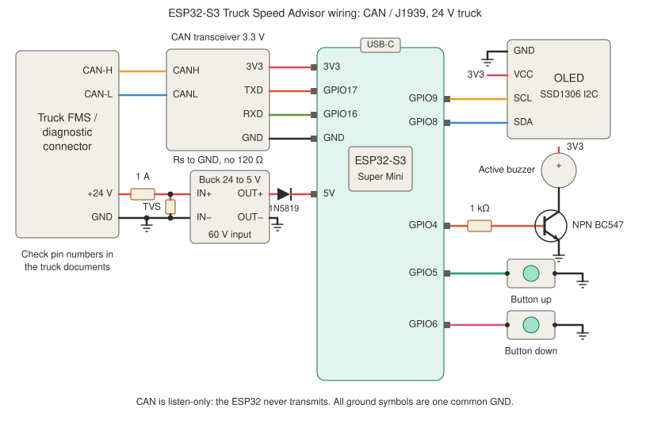

# ESP32-S3 Truck Speed Advisor (CAN / J1939)

A compact speed advisor for trucks. It reads the vehicle speed from the truck's CAN bus instead of from a GPS module, and alerts you when a configurable speed limit is exceeded.

It is the truck version of [ESP32-S3-Speed-Advisor](https://github.com/Claudiu1975/ESP32-S3-Speed-Advisor): same buttons, display, buzzer and alert behaviour, but the speed comes from the vehicle itself, so it works in tunnels and does not need satellites.

## Features

- Reads wheel-based speed (J1939 CCVS) and tachograph speed (J1939 TCO1) from the bus, 250 kbit/s
- **Listen-only CAN**: the ESP32 never transmits and never acknowledges frames, so it cannot disturb the truck's bus
- Configurable speed limit (default 90.0 km/h, 0.5 km/h steps with two buttons), saved across power cycles
- Visual and audible alert when the limit is exceeded:
  - Short beep every second
  - After 45 s: increasing beep frequency
  - At 55 s: continuous tone
  - Display flashes in sync with the buzzer
- No alert and `--` on the display when no fresh speed data arrives (2 s timeout)
- Powered from the truck's 24 V through a buck converter
- Displays: SSD1306 128×32 / 128×64 I2C, ST7735S SPI, ST7789V SPI
- Built-in bench simulator and a bus sniffer log to help with the first connection

## Disclaimer and safety

**This is an unofficial hobby project.** It is provided "as is" without warranty. Use at your own risk. It is **not** a certified speedometer, speed limiter or tachograph, and must not be used for legal speed compliance. Always obey traffic laws.

- **Connect to the truck's CAN bus only through the interface the manufacturer provides for third-party equipment.** Daimler's body-builder guide for the Actros 5 / Arocs 5 says that "under no circumstances can additional connections be made at the vehicle CAN", and describes the FMS interface (X167, a green 12-pin FMS plug) for third-party equipment, which converts vehicle data to J1939. Use that, not a splice into the vehicle's internal CAN wiring.
- **The truck electrical system is 24 V.** A normal 12 V converter, USB car charger or 5 V module without a high-voltage rating will be destroyed, and on a 24 V system voltage spikes are large. Use a converter rated for at least 60 V input, plus a fuse and a TVS diode as in the schematic.
- The device is **read-only**. Sending commands to the truck (windows, locks, and so on) is deliberately not part of this project: it needs transmit mode and vehicle-specific knowledge, and mistakes can affect safety systems.
- Do not let the display or the buzzer distract you while driving, and mount everything so it cannot move or touch hot or moving parts.
- Check the documentation of your truck and fit the fuse close to where you take power.

## How it gets the speed

Trucks use SAE J1939 on CAN at 250 kbit/s with 29-bit identifiers. The sketch decodes two standard messages, both with speed in 1/256 km/h per bit (values above `0xFAFF` mean "error / not available"):

| Message | PGN | Bytes | Meaning |
|---------|-----|-------|---------|
| CCVS | 65265 (0xFEF1) | 2–3 | Wheel-based vehicle speed (SPN 84) |
| TCO1 | 65132 (0xFE6C) | 7–8 | Tachograph vehicle speed (SPN 1624) |

By default the wheel-based speed is used, with the tachograph speed as a fallback (`SPEED_SOURCE` in the sketch). Wheel-based speed and tachograph speed can differ by a few percent. Neither is the same as the dashboard speedometer.

### What you must check on your own truck

- **Which connector and pins carry CAN-H, CAN-L, +24 V and GND.** This depends on the truck and its equipment. The schematic does not give pin numbers, because they must come from the manufacturer's documentation for your exact vehicle.
- **Whether the FMS interface is fitted and active.** On some trucks it is optional equipment or has to be enabled by a workshop.
- **Which messages your truck really sends.** Use the sniffer log (below) to see them.

## Hardware

- ESP32-S3 Super Mini (ESP32S3 Dev Module in the Arduino IDE)
- 3.3 V CAN transceiver module, e.g. SN65HVD230 or TJA1051T/3. **Remove or disable the 120 Ω termination resistor on the module**: the truck's bus is already terminated, and an extra resistor loads it. Tie `Rs` to GND if the module has that pin.
- 24 V → 5 V buck converter, at least 60 V input rating
- Fuse (about 1 A), TVS diode for 24 V systems (e.g. SMBJ33A), Schottky diode (1N5819) in the 5 V line
- One of the supported displays
- Active buzzer (e.g. TMB12A03), NPN transistor (BC547 / 2N2222 / 2N3904) and 1 kΩ resistor
- Two momentary push buttons
- Wires, connector for the truck side, enclosure

### Pin assignment (ESP32-S3 Super Mini)

| Function | GPIO | Notes |
|----------|------|-------|
| CAN RX | 16 | Transceiver RXD → ESP RX |
| CAN TX | 17 | ESP TX → transceiver TXD (never driven, listen-only) |
| Buzzer | 4 | Through the NPN transistor |
| Button up | 5 | Internal pull-up, other side to GND |
| Button down | 6 | Internal pull-up, other side to GND |
| I2C SDA | 8 | OLED |
| I2C SCL | 9 | OLED |
| TFT MOSI / SCK / CS / DC / RST | 11 / 12 / 10 / 7 / 15 | SPI displays, wired as in the GPS version |

Always verify the silkscreen on your specific board.

## Wiring



Pin positions on the board are drawn to keep the wires straight and do not match the physical header order. Wire by GPIO number.

- The 5 V from the buck converter goes to the **5V pin** through a Schottky diode. The diode stops the USB 5 V from feeding back into the converter when you program the board with the truck power connected. Better still, disconnect the truck power while programming.
- Power the unit from a **switched** 24 V supply (ignition-on), so it turns off with the truck.
- The ESP32 has a 3.3 V logic level, so the transceiver must be a 3.3 V part (or a module that runs on 3.3 V), not a 5 V-only one.

### Buzzer current warning

> **Warning:** A GPIO pin of the ESP32-S3 can only supply a limited current (about 40 mA absolute maximum, so keep the load well below 20 mA). In this design the buzzer is driven through an NPN transistor, so any small active buzzer is fine. If you connect a buzzer directly to GPIO4 instead, check its current rating first: a larger or louder one can damage the pin. HIGH on GPIO4 turns the buzzer on in both cases.

## Software setup

1. Install the **ESP32** board package (esp32 by Espressif, 2.0.14 or newer, preferably 3.x) and select **ESP32S3 Dev Module**, with **USB CDC On Boot: Enabled**.
2. Install the libraries: **Adafruit SSD1306**, **Adafruit GFX Library**, and (for TFT displays) **Adafruit ST7735 and ST7789 Library**. The CAN controller (TWAI) is part of the ESP32 core, so nothing else is needed.
3. Open `TruckSpeedAdvisor/TruckSpeedAdvisor.ino` and set the options at the top:

```cpp
#define DISPLAY_TYPE      1   // 0 = SSD1306 128x32, 1 = SSD1306 128x64, 2 = ST7735S, 3 = ST7789V
#define SPEED_SOURCE      0   // 0 = auto (CCVS, then TCO1), 1 = CCVS only, 2 = TCO1 only
#define SPEED_SOURCE_ADDR 0xFF // only accept one source address, or 0xFF for any
#define SIMULATE_SPEED    0   // 1 = bench test without a truck
#define DEBUG_PGN_LOG     1   // print the J1939 frames seen on the bus
```

4. Upload. Open the Serial Monitor at 115200 baud.

## First test

1. **Bench test, no truck:** set `SIMULATE_SPEED` to 1 and upload. The speed ramps 0 → 110 → 0 km/h every minute, which lets you check the display, the buttons and the buzzer.
2. **In the truck, ignition on:** set `SIMULATE_SPEED` back to 0. With `DEBUG_PGN_LOG` on, every new J1939 frame (PGN and source address) is printed once. Look for PGN 65265 (0xFEF1) and/or 65132 (0xFE6C). Every 5 seconds the log prints the current speed or "No speed data".
3. **No frames at all:** check CAN-H / CAN-L (swapped wires are common), the common ground, that the transceiver runs on 3.3 V, that the FMS interface is active, and that the bus really runs at 250 kbit/s.
4. **Frames but no speed:** the truck may send speed in another message or from another source address. Use the log and `SPEED_SOURCE_ADDR` to narrow it down.

## Usage

1. Power on. The display shows the speed limit. Use the buttons to change it in 0.5 km/h steps.
2. After 5 seconds without a button press, the limit is saved and the device switches to the speed display.
3. When the speed exceeds the limit, the buzzer and display work as described above. The speed must drop below the limit to reset the alert timer.

## License

MIT License. See [LICENSE](LICENSE).

## Credits

A human-and-AI project: Claudiu brought the idea and the truck, Claude wrote the code.

- ESP32 Arduino core and TWAI driver by Espressif Systems
- Adafruit SSD1306, GFX, ST7735 and ST7789 libraries
- Based on [ESP32-S3-Speed-Advisor](https://github.com/Claudiu1975/ESP32-S3-Speed-Advisor)
